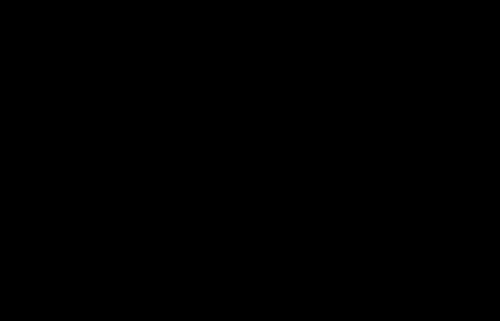

# 3D LiDAR Object Detection with Open3D

A classic (non-deep-learning) perception pipeline for 3D LiDAR point clouds: downsampling, ground removal, clustering, oriented bounding boxes and size-based classification. It runs on a simulated 32-beam automotive LiDAR scan and reads KITTI `.bin` files directly.



*Blue = car, red = pedestrian, orange = pole, grey = wall, purple = unknown. The robot car is in the centre; the grey arcs are the road, one arc per laser beam.*

## Pipeline

| Step | Method | Open3D call |
|---|---|---|
| 1. Downsample | voxel grid, 10 cm | `voxel_down_sample` |
| 2. Ground removal | RANSAC plane fit, 15 cm threshold | `segment_plane` |
| 3. Clustering | DBSCAN, eps = 0.5 m | `cluster_dbscan` |
| 4. Filter scraps | drop clusters with < 8 points or < 0.3 m height | NumPy |
| 5. Oriented boxes | L-shape fitting: search yaw 0–89° and keep the angle where points lie closest to the box edges | NumPy |
| 6. Classification | size rules for car, pedestrian, pole, wall | Python |

## Test scene

`make_street.py` builds a street with Open3D's ray-casting engine and fires a virtual LiDAR at it: 32 beams from −25° to +10°, 1,800 measurements per rotation, 60 m range, 2 cm range noise, mounted 1.7 m above the road. Because the true position of every object is known, the detections can be checked exactly.

## Results

| Object (ground truth) | Detected | Notes |
|---|---|---|
| 3 visible cars | 3 × car | rotated car: yaw **9°** (true 8.6°), size **4.5 × 1.8 m** (true 4.5 × 1.8 m) |
| 3 pedestrians | 3 × pedestrian | no false positives |
| 4 street lamps | 3 × pole | the lamp at 30 m returns too few points |
| car partly behind another car | unknown | only one side visible (occlusion) |
| van behind a car | unknown | only the roof is visible (occlusion) |

The two "unknown" cases are not a tuning problem: the points are simply not in the scan. Real systems handle this with tracking over time, learned detectors (for example PointPillars), or sensor fusion.

## Parameter studies

**Outlier filter** (`remove_statistical_outlier`, 20 neighbours) on an indoor scan of 12,369 points:

| std_ratio | Points removed | Predicted by a normal distribution |
|---|---|---|
| 3.0 | 0.7 % | 0.1 % |
| 2.0 | 2.7 % | 2.3 % |
| 1.0 | 12.9 % | 16 % |
| 0.5 | 29.6 % | 31 % |

At 2.0 the filter removes edge noise only; at 1.0 and below it starts deleting real wall points.

**DBSCAN `min_points`:** 10 split distant street lamps into pieces that were misclassified as pedestrians; 4 kept the lamps whole but turned distant wall scraps into fake objects, which the size filter (step 4) now removes.

**Voxel size:** the scene stays recognisable up to about 0.1 m; at 0.2 m small objects dissolve. A common rule of thumb is about one fifth of the smallest object of interest.

## Files

```
make_street.py   simulated 32-beam LiDAR scan of a street (writes street.pcd)
detect_v2.py     full detection pipeline with oriented boxes and screenshot export
detect.py        first version with axis-aligned boxes (for comparison)
first_cloud.py   basics: load, downsample, outlier removal on an indoor scan
experiment.py    parameter study: python experiment.py <voxel_size> <std_ratio>
```

## How to run

```bash
python3 -m venv ~/pc_venv && source ~/pc_venv/bin/activate
pip install -r requirements.txt
python make_street.py
python detect_v2.py street.pcd           # opens a 3D window and saves detections.png
python detect_v2.py 000000.bin           # a KITTI velodyne scan
```
Add `--no-show` to print the detections without opening a window.

## Limitations

- Rule-based classification by box size; no machine learning.
- Single scans; no tracking between frames.
- Tested mainly on simulated data; KITTI files load, but the size thresholds are not tuned for them yet.

## Skills

Python · NumPy · Open3D · point-cloud processing · RANSAC · DBSCAN · bounding-box fitting · LiDAR sensor characteristics (resolution, occlusion, blind spot, noise)

---
Built by Aayush Safi as a self-study project alongside an M.Sc. in Information Technology at TH OWL, Germany.
